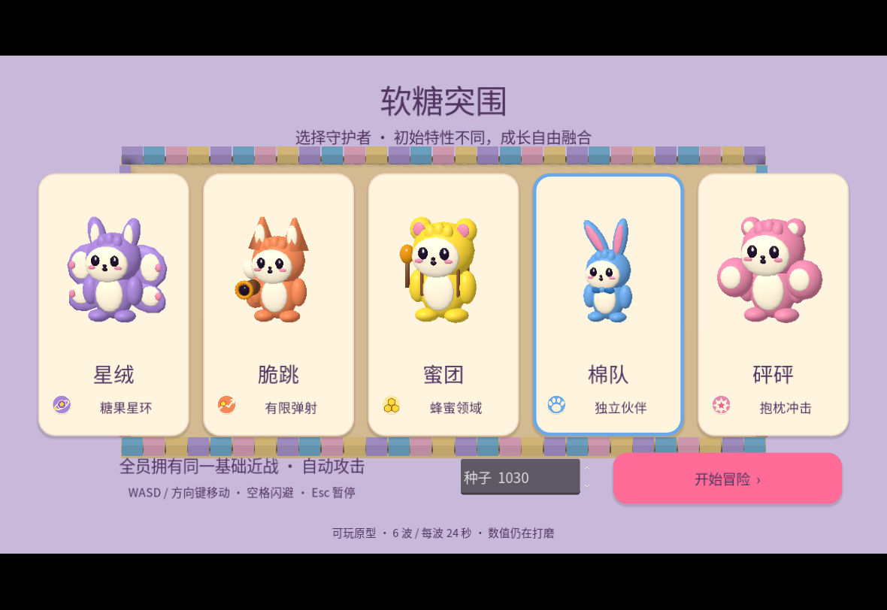
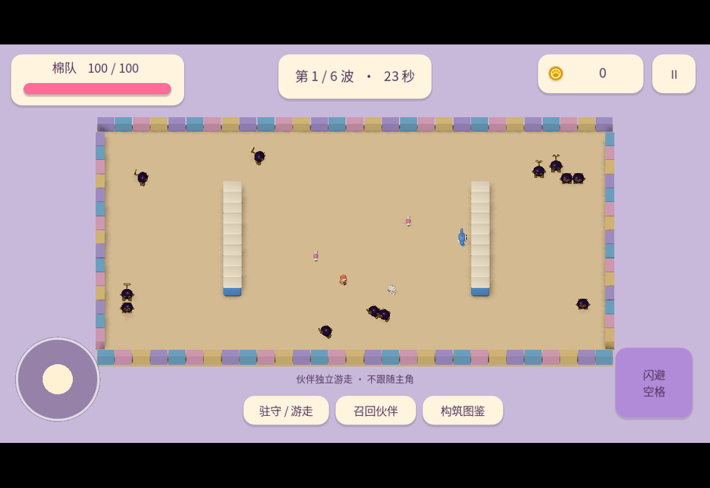

# 软糖突围 / HMI-Game

Godot 4.6.3 **.NET** / Compatibility 原型，纯 C# ECS 核心与引擎表现层分离。标准版 Godot 不能编译本项目。

> **当前为新版食物英雄接入中的分阶段原型，不是商业化完成版。** 五角色2D选人已换为获准概念形象：绯绫、卷卷、布叮、烤团、脆蓝；稳定技能ID、纯C#核心规则和无闪避约束保留。适配层的暂停/动作/表情与实体生命周期回归、选人实际窗口审查已通过。**五位新版食物英雄已接入局内3D，伙伴和敌人仍为原有资产。** 五位逐一开始/移动/暂停/重开、布叮正常前两波、选卡/商店/第三波和重开切烤团已通过实际窗口检查；最终资源/表情与取景修复另有独立证据。结构导入通过不等于手机性能或完整美术验收。见 [FEAT-0004](docs/features/FEAT-0004-food-heroes.md)、[资源合同](docs/food-hero-runtime-contract.md) 和 [B1范围/证据](docs/evidence/FEAT-0004/stageB-preasset/README.md)。
>
> 当前开发增量已加入8个分支/融合节点、6波后继续无尽、封顶后的6种单波临时契约，以及本机波起点恢复。E存档整合已通过最终总测与实际跨进程恢复/故障提示门（见[E里程碑](docs/features/E-host-integration.md)），仍不表示已远端发布；手机与长期无尽体验另验。旧动物角色、旧APK和棉队离线动画的历史证据不代表当前用户美术验收。历史2D修订记录见 [FEAT-0003](docs/features/FEAT-0003-2d-character-selection.md)。

## 运行

安装 Godot 4.6.3 .NET 和 .NET SDK 10.0.403，从仓库根目录执行：

```sh
dotnet build -m:1 HmiGame.csproj
godot-net --editor --path .
```

`godot-net` 指你的 Godot .NET 可执行文件，不是系统标准版。编辑器导入后 F5。命令行可用 `godot-net --path .`。

- WASD / 方向键或左下摇杆移动；自动攻击。
- 闪避已按最新要求移除：空格不触发加速或无敌。Esc 暂停；图鉴内 Esc 仅关闭图鉴。
- 五角色起点，共同基础近战；可跨角色学习特性。
- 波末免费三选一，然后可用击杀金币购买道具；必须选牌，但不强制购买。
- 伙伴可驻守或自主游走，不跟随主角、不受怪物攻击、不显示血条。
- 重开清空本局金币与构筑；“退出至选人”保留最近波起点。恢复会整体回滚本波进度；正式死亡/结束不会提供正常复活。详见[本机存档与失败边界](docs/checkpoints.md)。
- 有限六波完成后可明确结束或继续无尽。封顶类别提供明示单波契约，不是永久无限叠加。10–30波实际体验/平衡门尚未完成。

## 验证与边界

```sh
dotnet run --project tests/CoreTests/Hmi.CoreTests.csproj -c Release
```

[架构 ADR](docs/architecture/ADR-0001-portable-ecs.md) · [决策逐项 Review](docs/overnight-decisions-2026-10-30.md) · [设计](docs/game-design.md) · [开发日志](docs/development-log.md)

2026-10-31 云端工作区重置后，历史M2重建基线曾完成核心回归、原生桌面关键流程和 Linux 导出验证；这些导出不包含当前2D选人改动。之前未完整发布的 M1 源码、导出和截图已丢失，旧测试数量不能证明新代码通过。M2是历史证据，不代表当前增量。当前按 [E整合范围](docs/features/E-host-integration.md)、各阶段evidence与开发日志区分通过/未测；远端发布状态另行核验。

范围为六个24秒原型波次、一种追击敌人、五特性、21卡、4道具。数值非最终平衡；完整敌人阵容、声音、存档、Unity/团结迁移、Android真机和硬件GPU性能尚未验证。不要把 headless 运行当作画面或真机验证。

## 当前2D选人实机候选（用户视觉验收待确认）


[本次测试范围与已知限制](docs/evidence/FEAT-0003/validation-status.md)。截图为软件渲染桌面实际窗口，不是AI界面概念图，也不是手机性能证明。

## 历史 M2 云端运行画面（已被用户要求改进）

以下保留 M2 历史 Godot 原生截图，不代表当前修订候选画面或用户验收。修订说明见 [FEAT-0002](docs/features/FEAT-0002-visual-fidelity.md)。使用软件渲染，不能代表手机性能。




后续补充：[原生六波正常操作通关及桌面窗口缩放记录](docs/evidence/FEAT-0001/followups/native-full-run-20261031.md)。此证据不改变已交付M2源码包。
