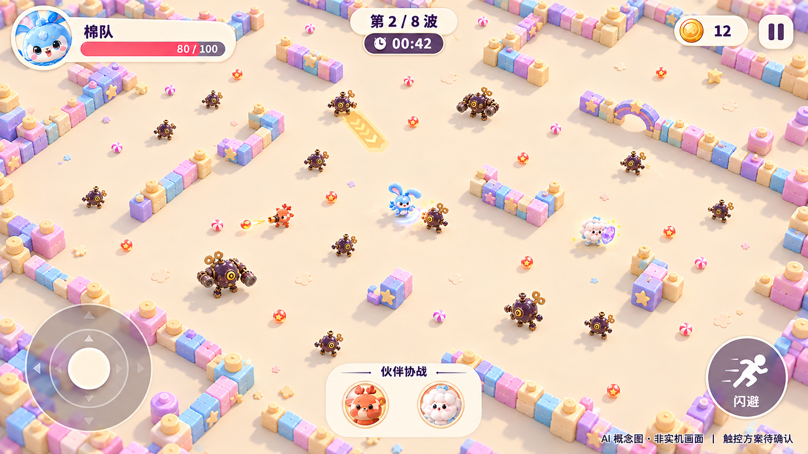
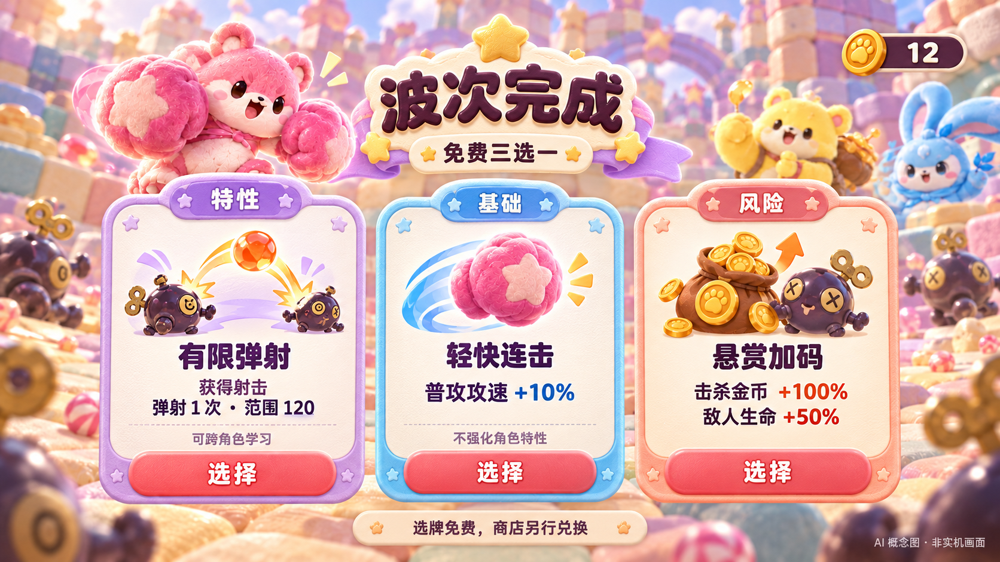
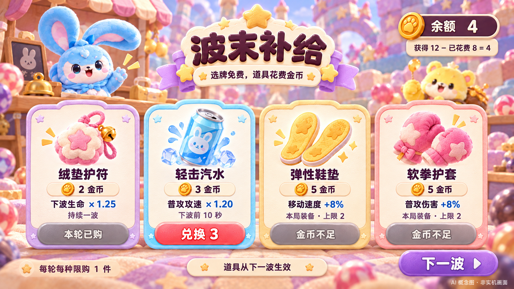
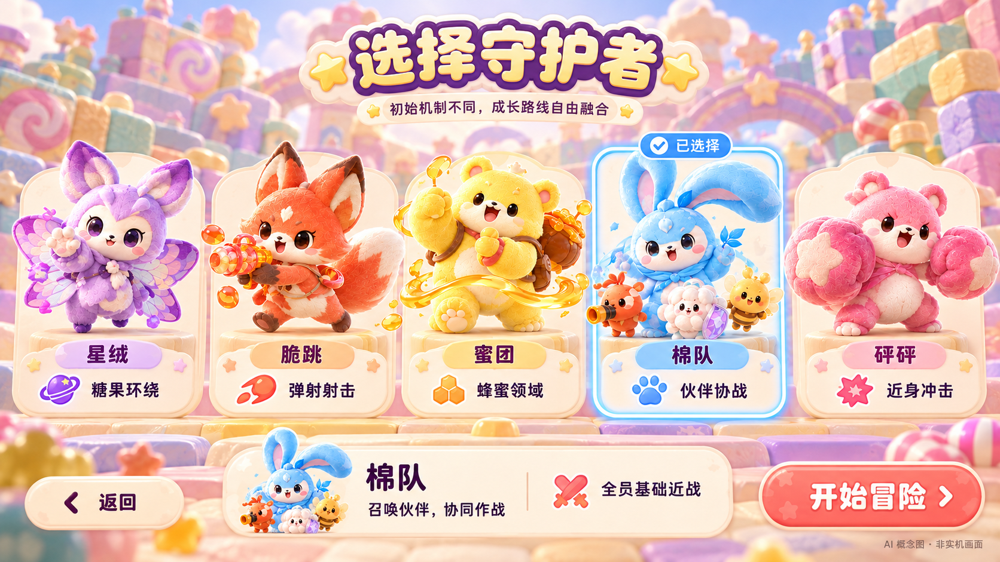

# 局内与 UI 美术参考（CHG-0005）

日期：2026-10-30。暂定名「软糖突围」。这四张图由 AI 生图工具根据本项目已批准的角色/发条机械敌人概念生成；用户已明确通过这四张图的 UI 提案，并要求作为仓库参考一并提交。**都是预期画面概念图，不是 Godot 实机截图、可运行 UI、最终生产素材或性能证据。** 图片原始 PNG 字节与分辨率保持不变，未压缩重绘。

## 图片索引

| 图片 | 版本 | 用途与阅读重点 |
| --- | --- | --- |
| [局内战斗](combat-open-v03.png) | combat-v03 / Library 版本 2 | 更远的高角度镜头、更大可见场地、连续无方格地面；实体墙体和缺口、独立伙伴、机械敌人与拾取物；保留玩家生命 HUD，伙伴无生命条。 |
| [波间三选一](wave-upgrades.png) | upgrades-v01 / Library 版本 0 | 区分随机特性获得/树节点升级、基础属性、明确代价的高风险收益三种卡位；留出大字号效果和负面效果空间。 |
| [波间金币商店](wave-shop.png) | shop-v01 / Library 版本 0 | 钱包/扣款账目、道具价格和效果、已购与余额不足状态；商店与免费三选一分开。 |
| [角色选择](character-select.png) | characters-v01 / Library 版本 0 | 五个角色初始特性与全员统一基础近战；蓝色棉队、亮黄色蜜团，以及其余已讨论角色配色。 |

## 已确认方向与最新修正

- 英雄守护糖果世界；入侵敌人是带发条、铆钉与齿轮的机械阵营，不是糖果怪物。
- 圆润明亮、玩具般 3D 材质；棉队为蓝色，蜜团为更明亮的黄色。图中外观用于延续视觉身份，不能替代模型/动画规格。
- 局内镜头更远、地图更大，角色在画面占比减小，以移动空间与怪群可读性为重点；不是照搬其他游戏资产。
- 地面去掉方格/棋盘/砖缝网格，用连续哑光浅色地面与清晰墙体几何、投影区分可行走区域和障碍。
- **伙伴是有独立世界坐标的单位，不挂在主角身上；伙伴不显示血条，怪物不攻击伙伴。** 这是 v0.9 HTML 归档之后用户明确补充的方向；不能根据旧提案或图中棉花伙伴盾牌外观推导“伙伴承伤坦克”。自主行动/驻留与具体技能仍以文字设计和后续确认定义。
- 三选一卡位结构、击杀金币兑换道具、五角色各自初始机制叠加共同基础近战，仍遵循[完整设计](../game-design.md)。

## UI 已通过；机制细节与数值不从图片自动冻结

- 用户已接受四张图的 UI 布局参考，包括横屏构图、左侧虚拟摇杆、右侧「闪避」按钮的视觉存在、底部伙伴区及卡片/商店/角色选择布局。
  这不等于确认闪避的无敌帧、冷却、距离、消耗、具体触发行为或最终交互参数；这些仍须单独设计与验证。
  图片页脚中「触控方案待确认」是生成时的历史文字，已被本次 UI 提案通过取代；按用户要求保留原图，不重绘图片。
- 生命 80/100、金币 12、波次 2/8、计时 00:42、卡片数值和道具价格是示意/原型值，不是最终平衡。
  全程 8 波提案与 HTML 的 6 波短演示不可混淆；数值规则查询 v0.9 机读目录/模拟附录，而非 OCR 图片。
- 角色选择图不是排他职业限制；可跨角色学习机制。当前选择角色不意味着其他英雄同时在战场。
- 静态图不能证明寻路、攻击目标、碰撞、金币扣款、冷却、触控、可访问性或设备性能已经实现/测试。
- 未来实现要继续验证小屏可读性、拇指遮挡、色弱区分、墙体遮挡、敌人预警与特效密度；不要因图片漂亮直接增加未经确认机制。

## 来源、版本与复核

来源为本次对话中的实际 AI 生图输出，参考既有原创角色、宣传图和发条敌人图；没有导入第三方游戏素材。用户明确授权将这四张最新图上传私有 Git 仓库作为参考；本记录不是新增第三方许可证或公开分发授权。

- `combat-open-v03.png` 是最新战斗图，替代旧 `combat.png` 和 `combat-wide-v02.png`；旧图不纳入本参考目录，避免误用旧网格与伙伴血条。
- 另外三张为原先 v01，未因战斗画面修正重绘。
- 四张均为 **1672 × 941** PNG，总计 **8,912,487 字节**。单图约 1.9–2.3 MiB，保留原分辨率用于视觉审阅。
- [manifest.json](manifest.json) 记录逐文件 SHA-256、精确字节、尺寸、版本、日期与原 Library 身份。Library ID 仅作溯源，不是下载凭证；不含签名 URL/token。
- 已检查 PNG 可解码、复制前后字节一致、最新战斗图无地面网格和伙伴血条；该检查不是游戏功能测试。
- 本次只添加参考图片和文档入口，不修改 Site、HTML、场景、项目设置或玩法代码。最新视觉/伙伴目标方向与 v0.9 历史快照有区别时，以本节明确更新为准，保留旧快照作为历史证据。
